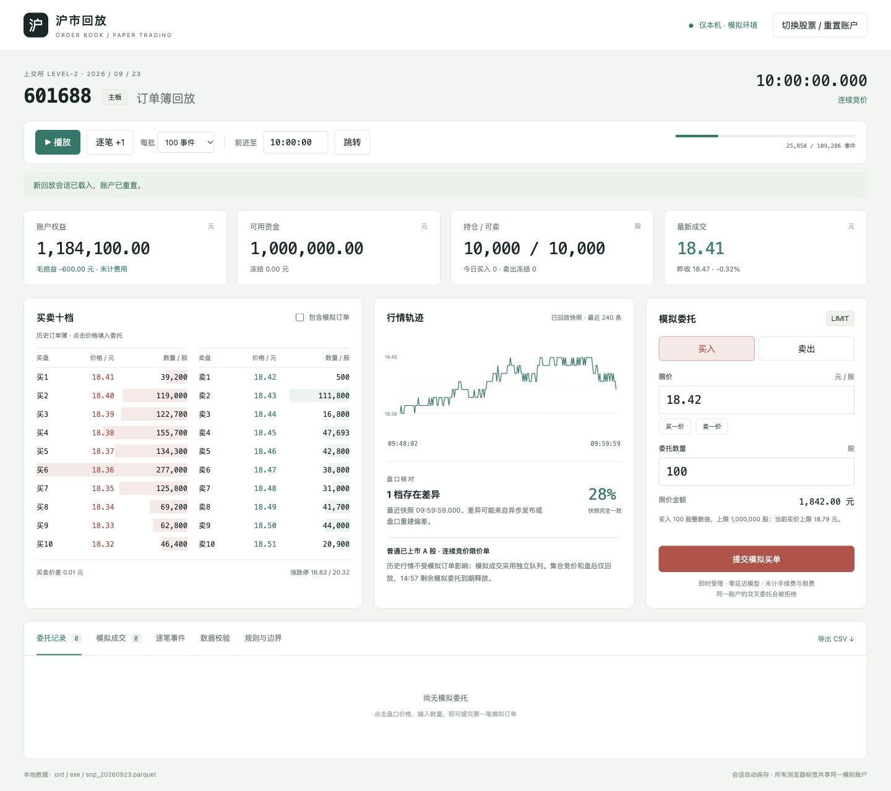

# 沪市订单簿回放与模拟交易

本地浏览器原型，使用 2026-09-23 的上交所 Level-2 数据重建历史订单簿，并在独立队列内模拟限价订单。没有券商接口，不会向真实市场报单。

## 启动

本机已安装的 Anaconda Python 含有 PyArrow，可直接双击 `start.command`，或在项目目录执行：

```bash
./start.command
```

打开 <http://127.0.0.1:8765>。终端中按 Ctrl+C 停止。端口默认仅绑定 `127.0.0.1`，不监听局域网地址。

```bash
./start.command --port 8766 --data-dir ~/Friday.18.40
```

其他电脑需要 Python 3.10+ 和 PyArrow：

```bash
python3 -m venv .venv
.venv/bin/pip install -r requirements.txt
.venv/bin/python server.py --data-dir /path/to/parquet
```

不需要 Node、npm 或前端构建，不使用 CDN。启动器依次使用 `SIM_PYTHON`、项目 `.venv`、本机 `/opt/anaconda3/bin/python`、`python3`。

## 使用

1. 默认证券 601688，初始资金 100 万元、昨日可卖持仓 10,000 股，成本以昨收计。行情从文件起点处理到 09:30，随后暂停。
2. “逐笔 +1”推进一个事件（包括源快照）；“播放”每 300ms 推进所选事件数量，不代表真实时间倍速。时间跳转仅能向前。
3. 点击十档价格填入限价，输入股数后提交。买一买单一般排队，卖一买单一般立即成交，具体以模拟队列剩余数量为准。
4. 委托表显示同价前方排队量、未成交量和撤单按钮。卖出只能使用昨日可卖持仓；今日买入单独显示。
5. “包含模拟订单”切换到模拟队列深度，带 `*` 的档位包含本账户挂单；默认深度始终为不受模拟订单影响的历史订单簿。
6. 数据校验页显示快照差异、未知撤单和未找到被动订单的成交；规则页列出模型边界。
7. 切换证券和回到过去时间需重置会话。会话保存在 `.runtime/session.json`，正常重启后按日志确定性恢复。重置替换当前会话，操作前可导出 CSV。

浏览器各标签共享一个账户；关闭浏览器不会关闭 Python 服务。记录表最多显示最近 500 条；CSV 导出全部，价格和金额列使用整数分，时间使用 `HHMMSSmmm`。

## 数据与回放

默认数据目录 `~/Friday.18.40`，包含：

- `ord_20260923.parquet`：新增、撤单、状态事件。
- `exe_20260923.parquet`：成交事件。
- `snp_20260923.parquet`：十档快照及昨收。

按单证券读取，使用 `(Time, Channel, BizIndex)` 排序，同通道同时间按业务序号排序；源快照在相同时间的逐笔事件之后核对。跨通道不存在可观测的交易所全局顺序，按时间和通道编号确定性排列。合并逐笔事件以 `(Channel, BizIndex)` 去重，数量保留在元数据中。源行情价格为 float32，读入时按 0.01 元恢复整数分，输入委托则严格拒绝非整分价格。

订单标识使用 `(Channel, OrderOriNo)`；成交引用对应 `BidOrder/AskOrder`。历史新增是已发布的剩余委托，不能把它当成撮合前客户报单再次与历史订单撮合。历史盘口按新增量、撤单量和成交引用扣减。成交中未找到主动方原始订单并不必然是丢包。

快照只用来核对，不强行覆盖订单簿。连续竞价快照的完全一致比例不是“订单簿准确率”：异步发布、时间戳对齐及原始数据口径均可能导致差异。十档完全一致也不能证明十档外或订单级排队准确。

## 模拟成交

模拟队列与历史盘口独立：

- 新增历史挂单按 FIFO 加入模拟队列；撤单根据原始订单号扣减，只有前方撤单减少前方排队。
- 模拟主动限价单按对手价格优先、同价 FIFO 消耗模拟队列；剩余部分加入本方队列。
- 历史主动成交使用方向、成交价和成交量驱动模拟被动成交：单笔成交量只在队列中分配一次，不向每张模拟订单重复分配。
- 后续历史新增剩余量若与更优先的模拟订单交叉，也可触发模拟成交；不重新撮合历史订单之间的成交。
- 历史成交方向未标明时不推断模拟被动成交。历史成交实际订单引用仍用于历史盘口扣减。
- 拒绝本账户交叉委托，避免未建模的自成交。

假设为零延迟、小订单不改变未来市场。模拟订单消耗过的流动性不会立即重复提供给本账户，但历史后续事件本身不会被反事实重写；不建模市场冲击、对手策略响应或真实网络延迟。模拟成交不能当成实盘成交保证。

## 规则范围

依据上交所《交易规则（2026年修订）》，2026-07-06 生效：

| 规则 | 主板 | 科创板 | 条文 |
|---|---|---|---|
| 买入限价数量 | 100 股整数倍，最多 100 万股 | 200–10 万股，超过 200 可逐股递增 | 3.3.8、3.3.9、6.7 |
| 卖出零股 | 零股部分须一次性卖出，不拆分零股 | 不足 200 股可卖余额一次卖清 | 3.3.8、6.7 |
| 最小价位 | 0.01 元 | 0.01 元 | 3.3.11 |
| 普通已上市涨跌幅 | ±10% | ±20% | 3.3.13、6.6 |
| 买入价格上界 | max(基准×102%, 基准+0.10) | 基准×102% | 3.3.14、6.8 |
| 卖出价格下界 | min(基准×98%, 基准−0.10) | 基准×98% | 3.3.14、6.8 |
| 排队 | 价格优先、同价先到先成交 | 同左 | 3.5.1 |

基准买入价依次回退到卖一、买一、最新成交、昨收；卖出反之。涨跌幅和有效申报价格范围四舍五入到分，并实施至少一分的变化及最低一分边界（3.3.17）。动态价格范围在报单时检查，不因后续价格变化而撤掉已受理的订单。

买入限价金额冻结；成交按实际成交价扣款，价格改善差额释放，剩余仍按限价冻结。卖出冻结昨日可卖持仓，成交扣减，撤单释放。当日买入不可当日卖出。账户权益包括冻结资金，避免重复扣减。

只接受连续竞价限价委托和撤单：09:30:00 ≤ t < 11:30:00、13:00:00 ≤ t < 14:57:00。午休保留未成交单。14:57 原型将剩余委托标记为到期并释放资产；这是连续竞价仿真的明确边界，并非交易所日单自动撤销规则。集合竞价和盘后可回放，但不模拟报单和成交。

不覆盖 IPO 前五个交易日、停复牌、除权除息、退市整理、特殊证券、市价单、集合竞价申报、盘后申报、跨日结算、券商适当性、手续费税费和真实交易接口。数据未附证券静态资料，所有可选代码按普通已上市股票解释，界面明确显示该假设。

用户提供的 Downloads 附件路径当时不存在，实际采用同名上交所官网附件。下载的原始 DOCX、正文提取以及暂缓实施附件保存在 `docs/`。官方页面：
https://www.sse.com.cn/lawandrules/sselawsrules2025/trade/universal/c/c_20260424_10816492.shtml

暂缓实施条文仅涉及本原型未实现的大宗交易相关事项。

## 检查

```bash
python -m unittest discover -s tests -v
```

规则与账务使用合成边界用例验证；集成测试在本地数据存在时使用真实的主板 601688 和科创板 688008，验证回放、被动订单引用、账户状态和会话恢复。

## 文件结构

- `server.py`：仅回环监听的 HTTP 服务、会话日志和 CSV 导出。
- `sse_sim/data.py`：按证券读取 Parquet 并排序。
- `sse_sim/book.py`：价格层级和订单 FIFO。
- `sse_sim/rules.py`：数量、价格、时间和 T+1 报单校验。
- `sse_sim/engine.py`：事件回放、模拟成交、冻结、持仓和快照诊断。
- `static/`：本地 HTML/CSS/JavaScript 操作页面。
- `tests/`：规则、撮合、账务及真实数据集成测试。

## 本次验证结果

- 27 项自动测试通过，包含真实主板和科创板数据的集成测试。
- 全部 50 只证券完成全天回放，处理 10,321,925 条逐笔与快照事件。
- 未知撤单、未找到被动订单的连续竞价成交、超量扣减、重复新增及重复业务事件均为 0。
- 连续竞价快照共核对 236,581 条，十档价量完全一致 67,480 条。其余差异仍需按供应商时间戳和发布口径进一步核对；不能据此宣称精确还原交易所队列。
- 浏览器验证：主动买入成交、被动买单排队与资金冻结、撤单释放、时间跳转、切换科创板、零底仓买入后的 T+1 卖出拒绝，以及桌面布局。

逐证券审计数据见 `docs/replay-audit.json`。可用以下命令重跑全量诊断：

```bash
PYTHONPATH=. python tests/audit_data.py
```

## 公开发布包

源码及验证资料可通过 GitHub 的 Code → Download ZIP 下载。原始 Parquet 行情及 `.runtime` 账户会话不随仓库发布，需自行准备有权使用的数据。可设置 `SSE_DATA_DIR` 或传入 `--data-dir` 指定目录。没有行情文件时，25 项合成测试仍可执行，2 项本地数据集成测试将跳过。


